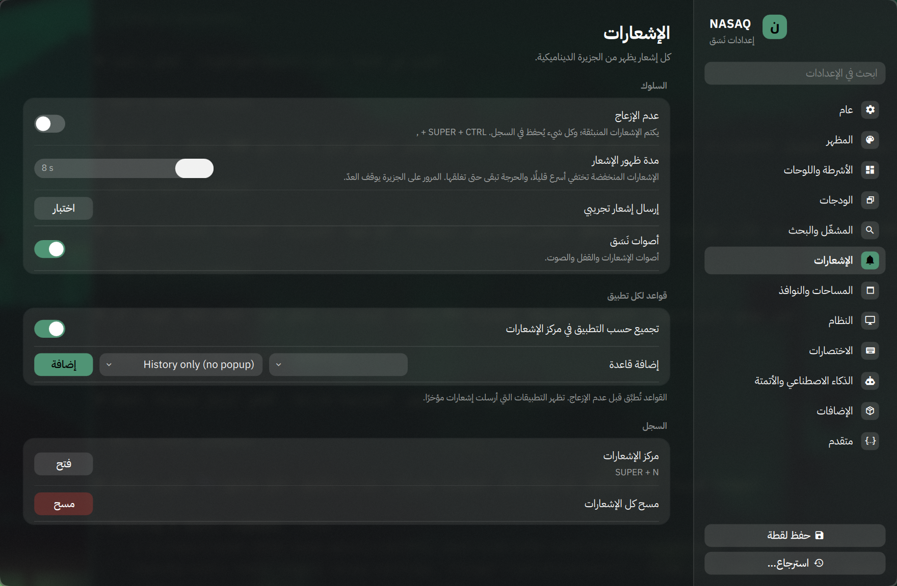

<div dir="rtl">

# نَسَق — NASAQ

[English](README.md)

**طبقة واجهة متكاملة فوق [Omarchy](https://omarchy.org) بتوجهات GHS (غازي حمد السيف).**
كما أن Omarchy مبني على توجهات DHH، نَسَق مبني على توجهات صاحبه: واجهة واحدة متناسقة، بلمسة macOS، تحترم العربية، وتُضبط كلها من نافذة إعدادات واحدة.


## الفلسفة

- **لا شِل ثانٍ.** نَسَق مجموعة إضافات تعمل داخل شل Omarchy نفسه (Quickshell)، بلا خدمة مكررة للإشعارات أو القفل أو الخمول.
- **لا نلمس Omarchy.** لا تعديل على `/usr/share/omarchy`؛ كل شيء في ملفات المستخدم، وتحديثات Omarchy تمر بأمان مع فحص تلقائي بعد كل تحديث.
- **كل شيء من واجهة.** كل خاصية لها مفتاح حقيقي في نافذة الإعدادات (SUPER + ALT + N)، وكل إضافة تُشغَّل وتُطفأ من صفحة الإضافات.
- **العربية أولًا.** اختصارات تعمل والتخطيط عربي، OCR عربي، ترجمة عبر Claude، أوقات الصلاة والتاريخ الهجري، وواجهة عربية من اليمين لليسار (تجريبية).

## ماذا يضيف

| الجزء | ما يفعله |
|---|---|
| الجزيرة الديناميكية | الساعة والتاريخ الهجري، الصلاة القادمة والتذكير بها، الآن يُشغَّل، مؤشرات الصوت والسطوع، الإشعارات، ساعة إيقاف، بومودورو |
| Spotlight (ALT + SPACE) | التطبيقات بترتيب الاستخدام، النوافذ المفتوحة، الملفات مع معاينة سريعة، حاسبة وعملات ووحدات، بحث الويب، و«? سؤال» لـ Claude |
| Mission Control (SUPER + TAB) | كل المساحات والنوافذ بمعاينات حية |
| مبدّل التطبيقات (ALT + TAB) | النوافذ بترتيب آخر استخدام مع معاينات |
| مركز التحكم (SUPER + ALT + C) | Wi-Fi وBluetooth والصوت والسطوع والطاقة وشكل النوافذ |
| عمود الودجات | الساعة، الصلاة، الطقس، المواعيد القادمة (iCal)، بطاقة النظام بالحرارة، الآن يُشغَّل، الملاحظات والمهام |
| الإشعارات | تخرج من الجزيرة، مع قواعد لكل تطبيق، تجميع، وعدم إزعاج |
| الاختصارات | محرر يغيّر أو يطفئ أي اختصار في Omarchy، وتحويل كل اختصارات الحروف لتعمل والتخطيط عربي |
| النوافذ | زوايا ساخنة، Scratchpads (طرفية منسدلة بـ SUPER + `)، قواعد نوافذ، شفافية وتمويه وحركات |
| النظام | الشاشات مع تراجع تلقائي، السطوع التلقائي، الأجهزة، الصحة، لقطات الإعدادات والاسترجاع |
| الذكاء الاصطناعي | ترجمة وتلخيص النص المحدد أو منطقة من الشاشة (SUPER + CTRL + ALT + L)، أتمتة مجدولة |

## التثبيت

يتطلب Omarchy 4.0.4 أو أحدث.

```bash
git clone https://github.com/ghazi-alsaif/nasaq ~/.local/share/nasaq
cd ~/.local/share/nasaq
./install.sh
```

- يأخذ نسخة احتياطية من كل ملف يعدّله (`shell.json` وملفات Hyprland الثلاثة والقائمة).
- يضيف سطرًا واحدًا في كل من `hyprland.lua` و`looknfeel.lua` و`bindings.lua`، وتبقى بقية ملفاتك كما هي.
- يعرض تثبيت الأدوات الاختيارية: `tesseract-data-ara matugen cava nwg-displays kitty ptyxis`.

ثم افتح الإعدادات بـ **SUPER + ALT + N** واختر مدينتك لأوقات الصلاة من الجزيرة.

## التحديث والإزالة

```bash
./update.sh           # يسحب آخر نسخة ويحدّث الملفات، وتبقى إعداداتك
./uninstall.sh        # يرجع ملفاتك كما كانت قبل التثبيت
./uninstall.sh --purge   # ويحذف إعدادات نَسَق أيضًا
```

## أين تُحفظ الأشياء

| المسار | المحتوى |
|---|---|
| `~/.config/omarchy/plugins/nasaq.*` | إضافات نَسَق |
| `~/.config/omarchy/nasaq/settings.json` | كل إعدادات نَسَق |
| `~/.config/omarchy/nasaq/secrets.json` | عناوين التقويم السرية (لا تدخل اللقطات ولا التصدير) |
| `~/.config/hypr/nasaq-*.lua` | وحدات Hyprland الخاصة بنَسَق (بعضها يُولَّد من الإعدادات) |
| `~/.local/bin/nasaq-*` | أدوات سطر الأوامر |

## الواجهة بالعربية



## الترخيص

MIT. أجزاء من الإضافات بدأت كنسخ من إضافات Omarchy (MIT)؛ التفاصيل في [NOTICE.md](NOTICE.md).

</div>
