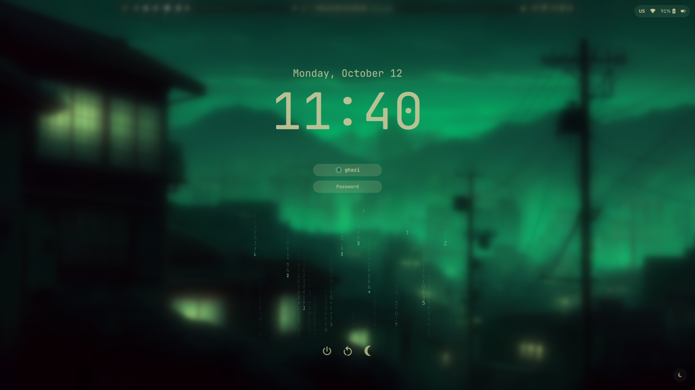
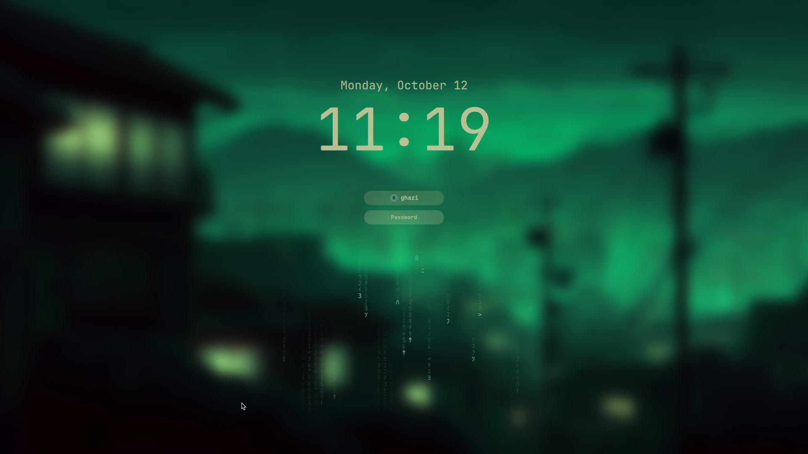
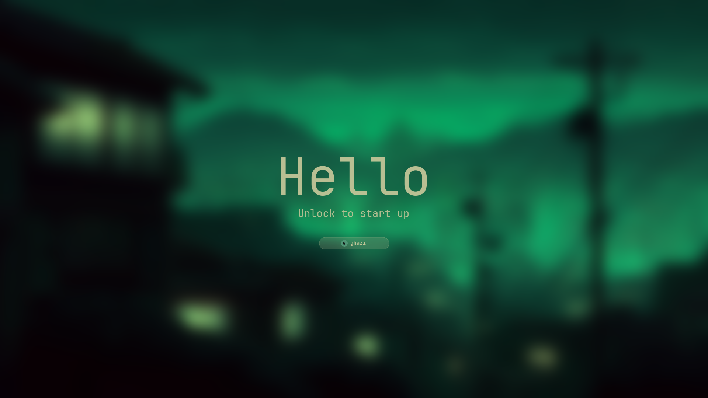

<h1 align="center">NASAQ (نَسَق)</h1>

<p align="center" dir="rtl"><strong>خط واحد لسطح مكتب <a href="https://omarchy.org">Omarchy</a> كله، من لحظة التشغيل إلى الإطفاء.</strong><br>
مستوحى من أفضل تجارب أنظمة التشغيل، ومبني لـ Hyprland.<br>
<a href="README.md">Read in English</a></p>

<p align="center">
<a href="https://github.com/ghazi-alsaif/nasaq/releases"></a>
<a href="https://omarchy.org"></a>
<a href="#اللغات"></a>
<a href="LICENSE"></a>
</p>

<p align="center"></p>

<div dir="rtl">

## ما هو نَسَق (وما ليس هو)

- **طبقة، لا نسخة معدّلة.** نَسَق مجموعة إضافات تعمل داخل Quickshell الخاص بـ Omarchy نفسه. لا شِل ثانٍ، ولا خدمة إشعارات ثانية، ولا شاشة قفل ثانية. وتحديثات Omarchy تستمر كالمعتاد.
- **لا نلمس `/usr/share/omarchy`.** نَسَق يسكن في `~/.config/omarchy/plugins` و`~/.config/hypr/nasaq-*.lua` و`~/.local/bin` و`~/.config/omarchy/nasaq`. وفحص بعد كل تحديث ينبّهك إذا غيّر Omarchy شيئًا يعتمد عليه نَسَق.
- **قابل للتراجع.** المثبّت يأخذ نسخة احتياطية من كل ملف يعدّله، و`uninstall.sh` يرجعها.
- **نافذة إعدادات واحدة.** `SUPER + ALT + N` يفتح إعدادات نَسَق: 12 صفحة بعناصر تحكم حقيقية لكل ميزة، منها صفحة الإضافات التي تشغّل وتطفئ أي إضافة في الشِل، سواء من نَسَق أو Omarchy أو المجتمع.
- **مظهر واحد من التشغيل إلى الإطفاء.** شاشات الإقلاع والدخول والقفل والإيقاف تشترك في تصميم شاشة القفل وتأخذ ألوانها وخلفيتها من ثيم Omarchy النشط.
- **العربية أولًا، والإنجليزية الافتراضية.** الواجهة تأتي بالإنجليزية ويمكن تحويلها للعربية مع اتجاه من اليمين لليسار. الاختصارات تعمل والتخطيط عربي، التعرّف على النص يقرأ العربية، وسطح المكتب يعرف التاريخ الهجري وأوقات الصلاة.

## الاسم

NASAQ هو الرسم اللاتيني لكلمة **نَسَق** العربية التي تعني الترتيب والانسجام والنمط المتناسق: أشياء مرتّبة على خط واحد ومتلائمة مع بعضها. Omarchy يعطيك أصلًا سطح مكتب Arch + Hyprland جميلًا بذوق DHH، ونَسَق ذوق شخص واحد فوقه: سطح مكتب كل قطعة فيه تشبه الأخرى شكلًا وسلوكًا، وكل شيء يُضبط من نافذة واحدة.

## الميزات

### الشريط العلوي

</div>

<p align="center"><br>
&nbsp;&nbsp;</p>

<div dir="rtl">

اليسار: قائمة Omarchy، مشغّلات التطبيقات المثبّتة، و**أرقام مساحات العمل**. المساحة النشطة مميّزة، والمساحات التي فيها نوافذ تظهر كاملة، والفارغة باهتة. الوسط: الجزيرة مع الساعة والعدّ التنازلي للصلاة القادمة. اليمين: أيقونات النظام، تخطيط لوحة المفاتيح، Wi-Fi وحالة الطاقة. مرّر العجلة فوق أرقام المساحات لتبديلها، أو فوق الجزيرة لتغيير الصوت. الشريط هو شريط Omarchy نفسه، ونَسَق يضيف عناصره عبر `shell.json`، فأوامر `omarchy bar` تبقى تعمل.

### الجزيرة

</div>

<p align="center"></p>

<div dir="rtl">

الجزيرة في أعلى الوسط عنصر حي: كبسولة واحدة يتغيّر شكلها حسب ما يحتاج انتباهك. مطويةً تعرض الوقت والعدّ التنازلي للصلاة القادمة. اضغطها فتتوسّع إلى بطاقة فيها التاريخ الميلادي والهجري، أوقات الصلوات الخمس لمدينتك، الطقس، ما يُشغَّل الآن، وساعة إيقاف ومؤقّت بومودورو. مؤشرات الصوت والسطوع والإشعارات تظهر بتحوّل الجزيرة نفسها لا كنوافذ منفصلة. وكذلك تنبيهات الحالة القصيرة: تشغيل Caps Lock وإيقافه، ولغة لوحة المفاتيح التي انتقلت إليها، وتوصيل الشاحن أو فصله.

### الإشعارات ومركز الإشعارات

</div>

<p align="center"></p>

<div dir="rtl">

الإشعار يخرج من الجزيرة بأيقونة التطبيق وعنوانه ونصّه ثم ينكمش. قواعد لكل تطبيق تتيح كتم إشعاراته أو تجميعها أو إبقاءها صامتة أثناء وضع عدم الإزعاج.

</div>

<p align="center"></p>

<div dir="rtl">

`SUPER + N` يُظهر مركز الإشعارات من اليمين: السجل مجمّعًا حسب التطبيق، مسح الكل، ومفتاح عدم الإزعاج.

### الإعدادات السريعة

</div>

<p align="center"></p>

<div dir="rtl">

`SUPER + ALT + C` أو زاوية ساخنة يفتح الإعدادات السريعة: Wi-Fi، Bluetooth، تخطيط لوحة المفاتيح، عدم الإزعاج، سطوع الشاشة مع السطوع التلقائي، الصوت مع اختيار المخرج، صفحة النوافذ (الشفافية والتمويه والظلال والشكل)، وضع الطاقة، والقفل / النوم / إعادة التشغيل / الإيقاف.

### ودجات سطح المكتب

عمود من الودجات الزجاجية يجلس على سطح المكتب خلف نوافذك (انظر الصورة في الأعلى): ساعة كبيرة مع التاريخ الميلادي والهجري، بطاقة الصلاة مع إبراز الصلاة القادمة وشريط تقدّم إليها، طقس مدينتك، بطاقة المواعيد القادمة من روابط تقويم iCal، بطاقة النظام بالمعالج والذاكرة والحرارة، ما يُشغَّل الآن مع أزرار التحكم، وبطاقة المهام / الملاحظات. `SUPER + ALT + D` يخفي العمود ويظهره.

رتّب العمود كما يناسبك من الإعدادات > الودجات:

- ضع العمود على اليسار أو اليمين أو على الجهتين (عمودان، وكل بطاقة في الجهة التي تختارها)، والنوافذ تترتّب حوله.
- لكل بطاقة مفتاح تشغيل وإطفاء، والعمود يسدّ الفراغ مكان البطاقة المطفأة.
- اسحب المقبض بجانب البطاقة لترتيب البطاقات كما تشاء.
- بطاقة المهام / الملاحظات تأخذ الارتفاع الذي تتركه البطاقات الأخرى أينما كانت.
- العدّ التنازلي للصلاة وصف الصلوات في الجزيرة لهما مفتاح مستقل، فأوقات الصلاة اختيارية بالكامل.

### البحث

</div>


<div dir="rtl">

`ALT + SPACE` يفتح البحث. اكتب لتجد التطبيقات (مرتّبة حسب كثرة وحداثة استخدامك لها)، النوافذ المفتوحة، والملفات، مع لوحة معاينة على اليمين تعرض الصور والنصوص والمستندات مع الحجم والتاريخ. ويجري البحث أيضًا العمليات الحسابية ويحوّل العملات والوحدات ويبحث في الويب. ابدأ السطر بـ `?` أو `؟` فيصير الباقي سؤالًا لوكيل Omarchy الافتراضي (Claude أو Codex أو OpenCode أو Copilot أو Gemini، أيّها يشير إليه `omarchy default agent`)، والجواب يظهر في مكانه. `CTRL + J / K` (أو `N / P`) تتنقّل بين النتائج. وإذا ثبّتَّ `libqalculate` يجيب البحث عمّا لا تقدر عليه حاسبته، مثل الجذور والمضروب والتواريخ (`today + 40 days`).

### النظرة العامة

</div>


<div dir="rtl">

`SUPER + TAB` أو السحب بثلاثة أصابع للأعلى أو الزاوية العلوية اليسرى يفتح النظرة العامة: معاينات حية لكل نافذة في المساحة الحالية مع شريط المساحات في الأعلى. اضغط نافذة لتنتقل إليها، أو اسحبها لمساحة أخرى. الضغط بالزر الأوسط يغلق النافذة، والزر الأيمن يعرض أوامرها (تعويم أو ترتيب، ملء الشاشة، نقل لمساحة، إغلاق). النوافذ مرتّبة كما هي على الشاشة، وبالزجاج نفسه الذي تراه على سطح المكتب.

### مبدّل التطبيقات

</div>

<p align="center"></p>

<div dir="rtl">

`ALT + TAB` يتنقّل بين النوافذ بترتيب آخر استخدام مع معاينات حية: أبقِ ALT مضغوطًا، اضغط TAB للتنقّل، وارفع ALT فيبدّل فورًا. هذا يحتاج قاعدة udev واحدة يعرضها المثبّت، وبدونها يستخدم المبدّل مؤقّتًا قصيرًا. وإطار واحد ينزلق من نافذة إلى نافذة مع كل ضغطة TAB.

### الحركة

كل شيء في نَسَق يتحرّك بإيقاع واحد، وبنفس المنحنيات التي يحرّك بها Hyprland نوافذك. الجزيرة تكبر إلى بطاقتها وترجع للشريط قطعة واحدة، واللوحات تنزلق متماسكة، وتظليل البحث ينساب بين النتائج، وصفحات الإعدادات تظهر بتلاشٍ ناعم. اختر «عادي» أو «مخفّفة» أو «إيقاف» من الإعدادات > المظهر > الحركة، ووضع توفير الطاقة يطفئها تلقائيًا.

### الزوايا الساخنة

ادفع المؤشر إلى زاوية لتنفيذ إجراء. الافتراضي: أعلى اليسار النظرة العامة، أعلى اليمين مركز الإشعارات، أسفل اليسار إظهار سطح المكتب، أسفل اليمين القفل. كل زاوية تُضبط من الإعدادات > مساحات العمل والنوافذ.

### الطرفية المنسدلة (Scratchpads)

</div>


<div dir="rtl">

`` SUPER + ` `` ينزل طرفية فوق ما تعمل عليه ويخفيها بنفس المفتاح. وأي تطبيق يمكن أن يكون Scratchpad: أضفه من الإعدادات > مساحات العمل والنوافذ بأمر ومفتاح وحجم.

### إعدادات نَسَق

</div>


<div dir="rtl">

`SUPER + ALT + N`. الصفحات: عام (لغة الواجهة واتجاهها، الخط، لقطات الشاشة، لغات التعرّف على النص)، المظهر، الأشرطة واللوحات (ومنها أزرار التطبيقات في الشريط، وأزرار إضافية تأتي بعد الافتراضية)، الودجات، المشغّل، الإشعارات، مساحات العمل والنوافذ، النظام (الشاشات مع تراجع تلقائي، السطوع التلقائي، الأجهزة، فحوصات الصحة)، الاختصارات، الذكاء الاصطناعي والأتمتة، الإضافات، متقدّم. كل إعداد يطبَّق فورًا. **حفظ لقطة** يسجّل كل ملفات نَسَق في مستودع git محلي، و**استرجاع** يعود إلى أي لقطة، والاسترجاع نفسه يمكن التراجع عنه.

</div>


<div dir="rtl">

صفحة الإضافات تعرض كل إضافة يعرفها الشِل مصنّفة إلى نَسَق وOmarchy والمجتمع، مع مفتاح لكل واحدة، وزر إعادة فحص، و"أضف إضافة من git". الإضافات التي يعتمد عليها بقية نَسَق معلّمة بـ Required.

</div>


<div dir="rtl">

صفحة الاختصارات تعرض كل الاختصارات، اختصارات Omarchy ونَسَق. كل واحد يمكن تغييره إلى مفتاح آخر أو إطفاؤه دون تعديل Lua يدويًا ودون خسارة تحديثات Omarchy: نَسَق يكتب طبقة إعادة تعيين صغيرة تُحمَّل قبل افتراضيات Omarchy. ومفتاح التخطيط العربي يعيد توليد كل اختصارات الحروف على أكواد المفاتيح، فتبقى `SUPER + W` و`SUPER + Q` وأخواتها تعمل ولوحة المفاتيح على العربية.

### شاشات الجلسة

</div>

<p align="center">&nbsp;&nbsp;</p>
<p align="center"></p>

<div dir="rtl">

من لحظة تشغيل الجهاز حتى إطفائه، كل شاشة بالتصميم نفسه: خلفيتك مضبّبة، ساعة كبيرة أو تحية، مطر Matrix بلون الثيم، وكبسولات زجاجية للاسم وكلمة المرور. كلها تأخذ ألوانها من ثيم Omarchy النشط وتتغيّر معه.

- **شاشة القفل** (`SUPER + CTRL + SPACE`): جزء من شِل نَسَق، بمسارين منفصلين لكلمة المرور والبصمة. تغيير الثيم يعيد رسمها مباشرة حتى وهي ظاهرة.
- **شاشة الدخول**: ثيم SDDM. أداة صغيرة مملوكة لـ root تعيد كتابة ألوانها وخلفيتها مع كل تغيير للثيم، وهي الشيء الوحيد الذي يثبّته نَسَق خارج مجلد المستخدم، مع قاعدة sudoers واحدة تسمح بهذه الأداة وحدها. مع الدخول التلقائي لا تظهر إلا بعد تسجيل الخروج.
- **شاشات الإقلاع والإيقاف**: ثيم Plymouth مع كبسولة فك تشفير القرص وتحية لكل حالة: Hello عند الإقلاع، See you soon عند إعادة التشغيل، Goodbye عند الإطفاء. الأداة نفسها ترسم الصور بألوان الثيم وتعيد بناء صورة الإقلاع مرة واحدة فقط عند تغيّرها (حتى دقيقة، في الخلفية).

### المزيد

- **تحية الطرفية**: معلومات النظام من fastfetch كلما فُتحت طرفية.
- **ملء الشاشة**: أثناء فيلم أو لعبة بملء الشاشة تنتظر الإشعارات بهدوء في مركز الإشعارات (الحرجة فقط تظهر، بدون صوت)، والزوايا الساخنة تتوقف.
- **البقاء مستيقظًا أثناء التشغيل**: الفيديو أو الموسيقى أو أي شيء بملء الشاشة يمنع شاشة التوقف والقفل التلقائي، دون أن يغيّر مفتاح «إبقاء الشاشة مستيقظة».
- **وضع الألعاب** (`SUPER + ALT + G` أو من الإعدادات السريعة): بلا حركات ولا تمويه ولا ظلال، والإشعارات هادئة، والزوايا الساخنة متوقفة. وإيقافه يعيد كل شيء.
- **الشاشة المقفلة**: الإشعارات التي تصل والشاشة مقفلة لا تظهر ولا ترنّ خلفها، بل تنتظر في مركز الإشعارات مع نقطة الجزيرة بعد فتح القفل.
- **الطاقة**: وضع توفير الطاقة وسلوك لكل وضع (توفير، متوازن، أداء).
- **الشاشة**: الدقة والمقياس والموضع مع تراجع تلقائي بعد 15 ثانية، وسطوع تلقائي من حسّاس الإضاءة أو الساعة.
- **الترجمة**: `SUPER + CTRL + ALT + L` يترجم النص المحدد، وأضف SHIFT للتعرّف على نص منطقة من الشاشة وترجمتها. كلاهما عبر وكيل Omarchy الافتراضي.
- **حافظة موحّدة**: `SUPER + C / V / X` نسخ ولصق وقص في كل تطبيق، حتى الطرفيات.
- **إغلاق التطبيق**: `SUPER + Q` يغلق التطبيق كاملًا لا نافذة واحدة.
- **إصلاح السماعات**: `SUPER + ALT + A` يعيد ربط بطاقة الصوت حين تصمت السماعات (iMac وبعض الحواسيب المحمولة).
- **الأتمتة** (أوامر بوقت أو بحدث) تُحرَّر من الإعدادات.
- **أوضاع شاشة التوقف**: Matrix، صورة، أو ASCII الأصلي في Omarchy.
- **يتبع الثيم**: كل أسطح نَسَق تتبع ثيم Omarchy النشط وتتجدّد عند تغييره.
- **إطار الشاشة** (مطفأ افتراضيًا): إطار ناعم مدوّر بلون الثيم داخل فجوات النوافذ.

## الاختصارات

| المفاتيح | الإجراء |
|---|---|
| `SUPER + ALT + N` | إعدادات نَسَق |
| `ALT + SPACE` | البحث |
| `ALT + TAB` | مبدّل التطبيقات |
| `SUPER + TAB` | النظرة العامة |
| `SUPER + N` | مركز الإشعارات |
| `SUPER + ALT + C` | الإعدادات السريعة |
| `SUPER + ALT + D` | إظهار / إخفاء ودجات سطح المكتب |
| `SUPER + ALT + G` | وضع الألعاب |
| `` SUPER + ` `` | الطرفية المنسدلة |
| `SUPER + Q` | إغلاق التطبيق |
| `SUPER + C / V / X` | نسخ / لصق / قص موحّد |
| `SUPER + CTRL + ALT + L` | ترجمة النص المحدد |
| `SUPER + CTRL + ALT + SHIFT + L` | ترجمة منطقة من الشاشة (OCR) |
| `SUPER + ALT + A` | إصلاح السماعات |
| `?` أو `؟` في البحث | سؤال الوكيل الافتراضي |

كل اختصارات Omarchy تبقى كما هي، وأي واحد منها يمكن تغييره من صفحة الاختصارات.

## المتطلبات

- Omarchy 4.0.4 أو أحدث، وهو يأتي بـ Hyprland 0.56+ وQuickshell 0.3+. نَسَق يستخدم إعدادات Hyprland بلغة Lua ونظام إضافات Omarchy.
- حزم يثبّتها المثبّت إن لم تكن موجودة (والمثبّت منها مسبقًا يُترك كما هو): `tesseract-data-ara` (التعرّف على النص العربي)، `cava` (مؤثر بصري للصوت)، `nwg-displays` (ترتيب الشاشات بواجهة رسومية)، `kitty` و`ptyxis` (طرفيات Scratchpad)، `libqalculate` (حاسبة أقوى في البحث)، `fastfetch` (تحية الطرفية).
- لشاشتي الدخول والإقلاع: SDDM وPlymouth (كلاهما جزء من Omarchy)، وImageMagick، وخط monospace (JetBrains Mono أو نسخته Nerd Font، وإلا أي خط monospace).
- اختياري: أحد وكلاء Omarchy (`claude` أو `codex` أو `opencode` أو `copilot` أو `gemini`) للأسئلة في البحث والترجمة.
- أوقات الصلاة من [AlAdhan](https://aladhan.com)، الطقس من [Open-Meteo](https://open-meteo.com)، أسعار العملات من [open.er-api.com](https://open.er-api.com). كلها مجانية ولا تحتاج مفتاحًا.

## التثبيت

</div>

```bash
git clone https://github.com/ghazi-alsaif/nasaq ~/.local/share/nasaq
cd ~/.local/share/nasaq
./install.sh
```

<div dir="rtl">

المثبّت:

1. يتحقق من إصدار Omarchy ويأخذ نسخة احتياطية من `shell.json` وملفات Lua الثلاثة لـ Hyprland وملحق القائمة في `~/.local/state/nasaq/`؛
2. ينسخ الإضافات والأدوات والـ hooks والأصوات والافتراضيات إلى مجلد المستخدم؛
3. يضيف سطر `pcall(dofile, ...)` واحدًا في كل من `hyprland.lua` و`looknfeel.lua` و`bindings.lua` لتُحمَّل طبقات نَسَق مع ملفاتك؛
4. يضيف عناصر نَسَق إلى الشريط ومدخلاته إلى قائمة Omarchy؛
5. يثبّت الحزم الناقصة وقاعدة udev لمبدّل التطبيقات؛
6. يثبّت شاشة دخول نَسَق (`sudo`؛ يثبّت الثيم في `/usr/share/sddm/themes/nasaq-login` ويختاره في `/etc/sddm.conf.d/zz-nasaq-login.conf`، ولتتبع تغيير الثيم يضيف قاعدة sudoers واحدة `/etc/sudoers.d/nasaq-login` تسمح لك بتشغيل أداة واحدة يملكها root هي `/usr/local/bin/nasaq-login-sync` ولا شيء غيرها) وتحية الطرفية (كتلة معلَّمة في `~/.bashrc`، ولا يكتب أبدًا فوق `~/.config/fastfetch` موجود). و`--update` يثبّتهما أيضًا ما داما ناقصين؛
7. يثبّت شاشات الإقلاع والإيقاف (`sudo`؛ يثبّت ثيم Plymouth باسم `nasaq` ويختاره ويحفظ اسم الثيم السابق، ويعيد بناء صورة الإقلاع مرة واحدة؛ ويستخدم نفس الأداة الوحيدة وقاعدة sudoers التي تستخدمها شاشة الدخول)؛
8. يعيد تشغيل الشِل.

لا شيء اختياري ولا أسئلة: نَسَق تجربة واحدة متكاملة. وإن فشلت خطوة (بلا كلمة مرور أو بلا إنترنت) يكمل الباقي، وتشغيل `./install.sh --update` لاحقًا يكملها. ثم اضغط `SUPER + ALT + N`.

اختر مدينتك لأوقات الصلاة والطقس من الإعدادات > الودجات، ولغة الواجهة من الإعدادات > عام.

## التحديث

</div>

```bash
cd ~/.local/share/nasaq && ./update.sh
```

<div dir="rtl">

`update.sh` يسحب آخر إصدار ويشغّل `install.sh --update` الذي يحدّث ملفات نَسَق ويترك ترتيب شريطك وقائمتك وإعداداتك كما هي.

### تحديثات Omarchy

نَسَق يُبقي نفسه في مكانه حين يغيّر Omarchy ما تحته. تعمل أداة `nasaq-doctor` بعد كل `omarchy update`، ويشغّلها مراقب كلما أُعيدت كتابة `~/.config/hypr/hyprland.lua` (لأن Update › Config › Hyprland في Omarchy يعيد ضبط ذلك المجلد دون تشغيل خطافات التحديث). تعيد ما أضافه نَسَق: أسطره في ملفات Hyprland، وعناصر شريطه ومركزه في `shell.json`، وإبقاء إضافات Omarchy التي يحلّ محلها مطفأة، ومدخلاته في القائمة، واختيار شاشة الدخول. تدمج التغييرات في ملفاتك (بعد نسخة احتياطية في `~/.local/state/nasaq/doctor-backup/`)، ولا تعيد تشغيل إضافة من نَسَق أطفأتها أنت. ويصلك إشعار واحد بما فعلته. وإذا أعاد Omarchy ضبط مجلد Hyprland كله، فالأمر `nasaq-doctor --restore-hypr` يعيد أسطرك أنت من قبل إعادة الضبط أيضًا. شغّل `nasaq-doctor` في أي وقت للفحص، أو من الإعدادات › متقدّم.

## الإزالة

</div>

```bash
cd ~/.local/share/nasaq && ./uninstall.sh          # يرجع الملفات المحفوظة احتياطيًا
cd ~/.local/share/nasaq && ./uninstall.sh --purge  # ويحذف إعدادات نَسَق أيضًا
```

<div dir="rtl">

ترجع شاشات الإقلاع وشاشة الدخول إلى ما كانت عليه قبل نَسَق (وتُعاد صورة الإقلاع مرة واحدة)، وتُزال كتلة تحية الطرفية من `~/.bashrc`. أما `~/.config/fastfetch` فيبقى لأنه قد يكون ملفك أنت.

## أين تُحفظ الأشياء

| المسار | المحتوى |
|---|---|
| `~/.config/omarchy/plugins/nasaq.*` | الإضافات الـ 21 |
| `~/.config/omarchy/nasaq/` | settings.json وisland.json وwindows.json والمساعدة |
| `~/.config/omarchy/nasaq/secrets.json` | روابط التقويم الخاصة (لا تُصدَّر ولا تدخل اللقطات) |
| `~/.config/hypr/nasaq-*.lua` | طبقات Hyprland المولَّدة (الاختصارات، القواعد، الزوايا، Scratchpads، اختصارات العربية، إعادة التعيين) |
| `~/.local/bin/nasaq-*` | الأدوات المساعدة (لقطات الإعدادات، الشاشة، الترجمة، Scratchpads، ...) |
| `~/.local/share/nasaq-data/` | المهام والملاحظات |
| `~/.local/share/nasaq-login/` و`~/.local/share/nasaq-plymouth/` | نسختك من ثيمي الدخول والإقلاع |
| `/usr/share/sddm/themes/nasaq-login` و`/usr/share/plymouth/themes/nasaq` | ثيما الدخول والإقلاع المثبّتان (ملك root) |
| `/usr/local/bin/nasaq-login-sync` و`/etc/sudoers.d/nasaq-login` | الأداة التي تبقيهما على الثيم، والقاعدة الوحيدة التي تسمح بها |
| `~/.local/state/nasaq/` | النسخ الاحتياطية للتثبيت |
| `~/.local/share/nasaq-settings/` | مستودع اللقطات |
| `~/.local/share/nasaq-data/` | بياناتك: مهام وملاحظات سطح المكتب (`notes.json`) |

## اللغات

واجهة نَسَق متاحة بـ **الإنجليزية** (الافتراضية) و**العربية** مع اتجاه تلقائي من اليمين لليسار. قوائم Omarchy نفسها (مثل `SUPER + SPACE`) تبقى بالإنجليزية. التعرّف على النص العربي والتقويم الهجري يعملان أيًا كانت لغة الواجهة.

## الشكر والترخيص

نَسَق من صنع **GHS (غازي حمد السيف)** فوق [Omarchy](https://omarchy.org) من DHH والمساهمين، و[Hyprland](https://hyprland.org) و[Quickshell](https://quickshell.org). عدة إضافات بدأت كنسخ من إضافات Omarchy نفسها أو استوحت أفكارها من إضافات المجتمع المذكورة في [NOTICE.md](NOTICE.md).

رخصة MIT. انظر [LICENSE](LICENSE) و[CHANGELOG.md](CHANGELOG.md).

</div>
