<h1 align="center">NASAQ (نَسَق)</h1>

<p align="center"><strong>An opinionated, macOS-flavoured, Arabic-aware desktop layer for <a href="https://omarchy.org">Omarchy</a>.</strong><br>
<a href="README.ar.md">اقرأ بالعربية</a></p>

<p align="center">
<a href="https://github.com/ghazi-alsaif/nasaq/releases"></a>
<a href="https://omarchy.org"></a>
<a href="#languages"></a>
<a href="LICENSE"></a>
</p>

<p align="center">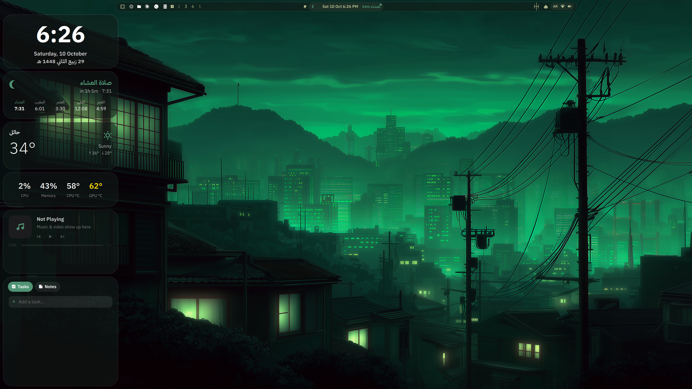</p>

## What NASAQ is (and is not)

- **A layer, not a fork.** NASAQ is a set of plugins that run inside Omarchy's own Quickshell process. There is no second shell, no second notification daemon, no second lock screen. Omarchy keeps updating normally.
- **Nothing under `/usr/share/omarchy` is touched.** NASAQ lives in `~/.config/omarchy/plugins`, `~/.config/hypr/nasaq-*.lua`, `~/.local/bin` and `~/.config/omarchy/nasaq`. A post-update check warns you if an Omarchy update changed something NASAQ builds on.
- **Reversible.** The installer backs up every file it changes. `uninstall.sh` puts them back.
- **One settings window.** `SUPER + ALT + N` opens NASAQ Settings: 12 pages with real controls for every feature, including a Plugins page that turns any shell plugin on or off, NASAQ's, Omarchy's or a community one.
- **Arabic first, English default.** The interface ships in English and can be switched to Arabic, with right-to-left layout. Shortcuts keep working under the Arabic keyboard layout, OCR reads Arabic, and the desktop knows the Hijri date and prayer times.

## The name

NASAQ is the Latin spelling of the Arabic word **نَسَق** (*nasaq*), which means *order, harmony, a consistent pattern*: things arranged so they follow one line and fit together. Omarchy already gives you a beautiful Arch + Hyprland desktop shaped by DHH's taste. NASAQ is one person's taste layered on top of it: a desktop where every piece looks and behaves like the others, and everything is configured from one window.

## Features

### The bar

<p align="center">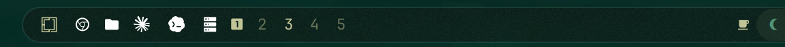<br>
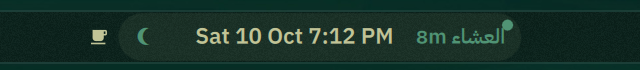&nbsp;&nbsp;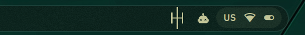</p>

Left: the Omarchy menu, pinned app launchers, and the **workspace numbers**. The active workspace is highlighted, workspaces that hold windows are shown in full, empty ones are dimmed. Centre: the Dynamic Island with the clock and the next prayer countdown. Right: tray, keyboard layout, Wi-Fi and power state. The bar is Omarchy's bar. NASAQ adds its widgets to it through `shell.json`, so `omarchy bar` commands still work.

### Dynamic Island

<p align="center">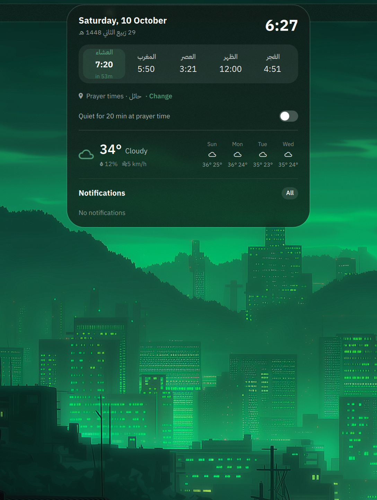</p>

The island in the top centre is a living element, in the spirit of Apple's Dynamic Island. Collapsed, it shows the time and the countdown to the next prayer. Click it and it expands into a card with the Gregorian and Hijri dates, the five prayer times for your city, the weather, what is playing, and a stopwatch and pomodoro timer. Volume and brightness OSDs, and notifications, appear by morphing the island itself rather than as separate pop-ups.

### Notifications and Notification Center

<p align="center">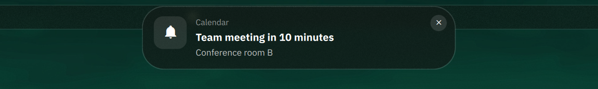</p>

A notification grows out of the island, with the app icon, title and body, then shrinks back. Per-app rules let you mute, group, or keep an app's notifications quiet while Do Not Disturb is on.

<p align="center">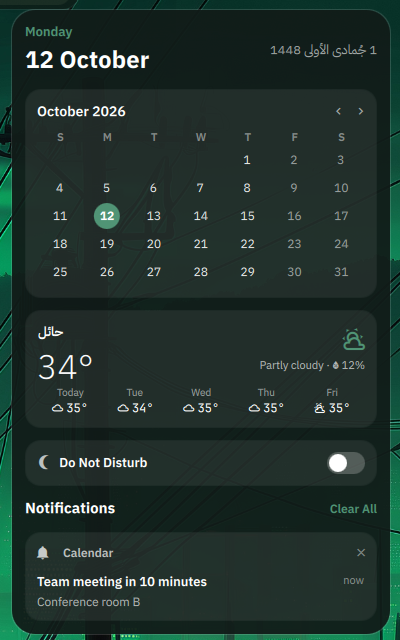</p>

`SUPER + N` slides the Notification Center in from the right: history grouped by app, clear-all, and a Do Not Disturb switch.

### Control Center

<p align="center">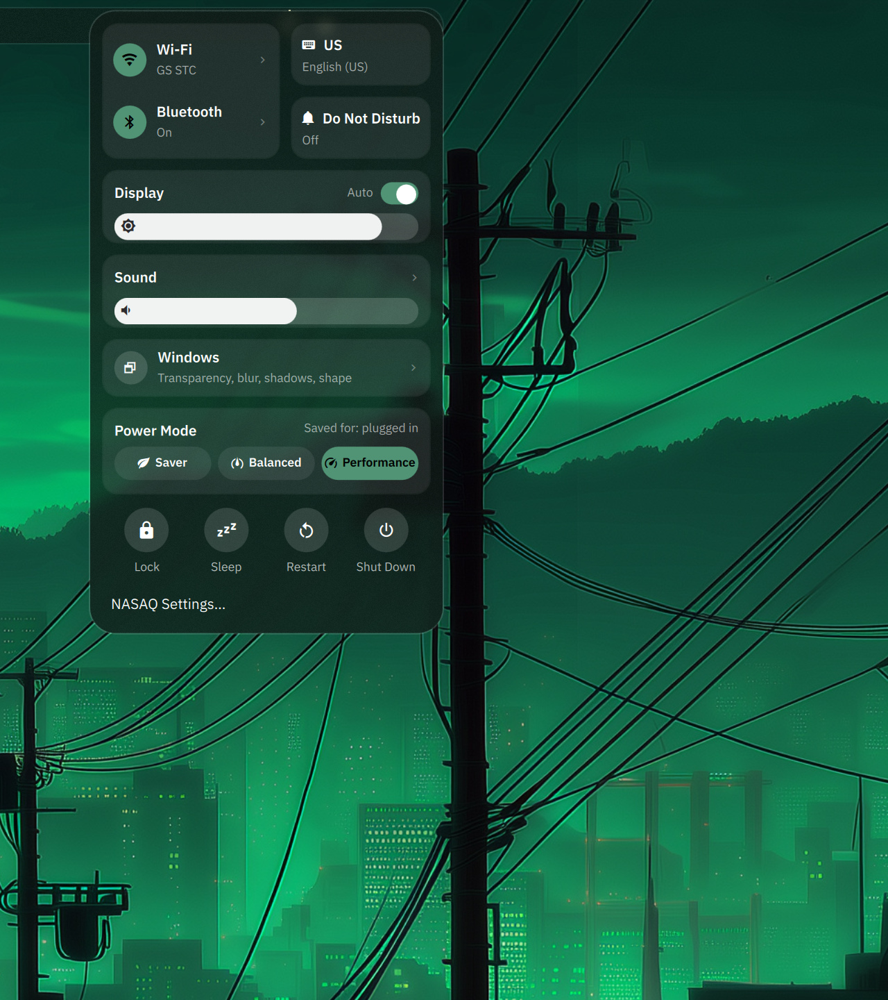</p>

`SUPER + ALT + C`, or a hot corner, opens a macOS-style Control Center: Wi-Fi, Bluetooth, keyboard layout, Do Not Disturb, display brightness with auto-brightness, sound with an output picker, a Windows page (transparency, blur, shadows, shape), power profile, and lock / sleep / restart / shut down.

### Desktop widgets

A column of glass widgets sits on the desktop behind your windows (see the screenshot at the top): a large clock with the Gregorian and Hijri dates, the prayer card with the next prayer highlighted and a progress bar to it, weather for your city, an Up Next card fed by iCal calendar links, a system card with CPU, memory and temperatures, Now Playing with media controls, and a Tasks / Notes card. `SUPER + ALT + D` hides and shows the column. Each widget can be turned off in Settings > Widgets.

### Spotlight

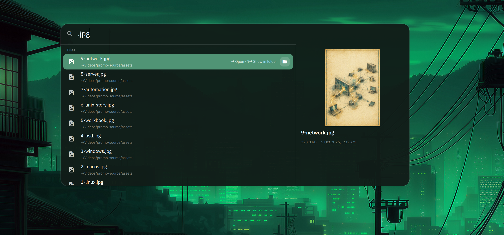

`ALT + SPACE` opens Spotlight. Type to find apps (ranked by how often and how recently you open them), open windows, and files, with a Quick Look pane on the right that previews images, text and documents and shows size and date. Spotlight also does arithmetic, currency and unit conversion, and web search. Start a line with `?` or `؟` and the rest is a question for your default Omarchy agent (Claude, Codex, OpenCode, Copilot or Gemini, whichever `omarchy default agent` points at). The answer appears inline.

### Mission Control

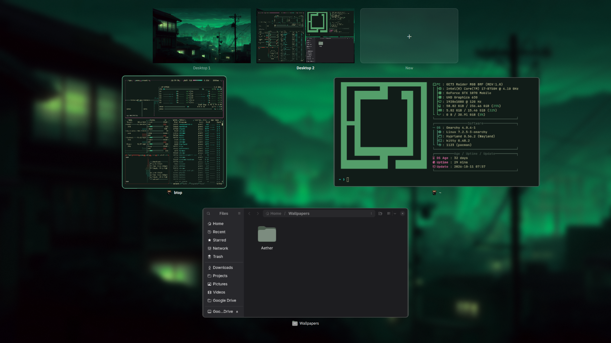

`SUPER + TAB`, a three-finger swipe up, or the top-left hot corner opens Mission Control: live previews of every window on the current workspace, with the workspace strip at the top. Click a window to focus it, drag it to another workspace, or middle-click to close it.

### App Switcher

<p align="center">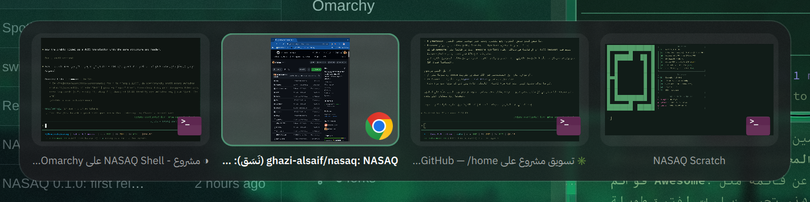</p>

`ALT + TAB` cycles windows in most-recently-used order with live previews, exactly like macOS: hold ALT, press TAB to move, release ALT to switch instantly. This needs one udev rule, which the installer offers; without it the switcher falls back to a short timer.

### Hot corners

Push the pointer into a corner to trigger an action. Defaults: top-left Mission Control, top-right Notification Center, bottom-left show desktop, bottom-right lock. Each corner is set from Settings > Workspaces & Windows.

### Scratchpads

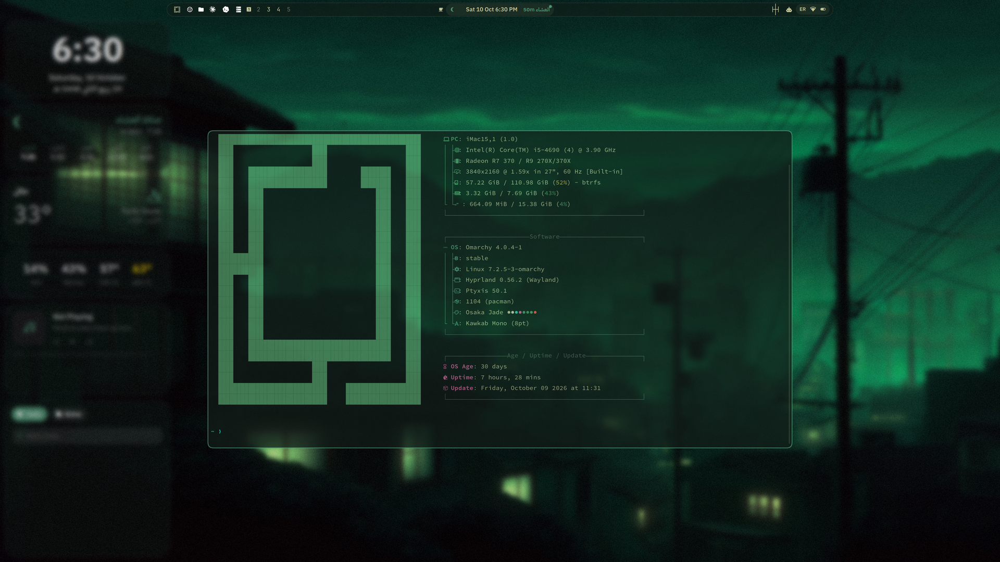

`` SUPER + ` `` drops a terminal over whatever you are doing and hides it again with the same key. Any app can be a scratchpad: add one in Settings > Workspaces & Windows with a command, a key and a size.

### NASAQ Settings

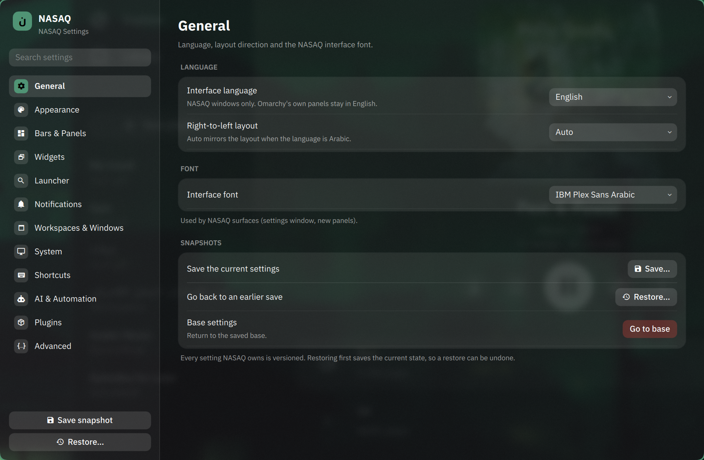

`SUPER + ALT + N`. Pages: General (interface language and direction, font, screenshots, OCR languages), Appearance, Bars & Panels, Widgets, Launcher, Notifications, Workspaces & Windows, System (displays with automatic revert, auto-brightness, devices, health checks), Shortcuts, AI & Automation, Plugins, Advanced. Every setting takes effect immediately. **Save snapshot** records all of NASAQ's files in a local git repository; **Restore** goes back to any snapshot, and a restore can itself be undone.

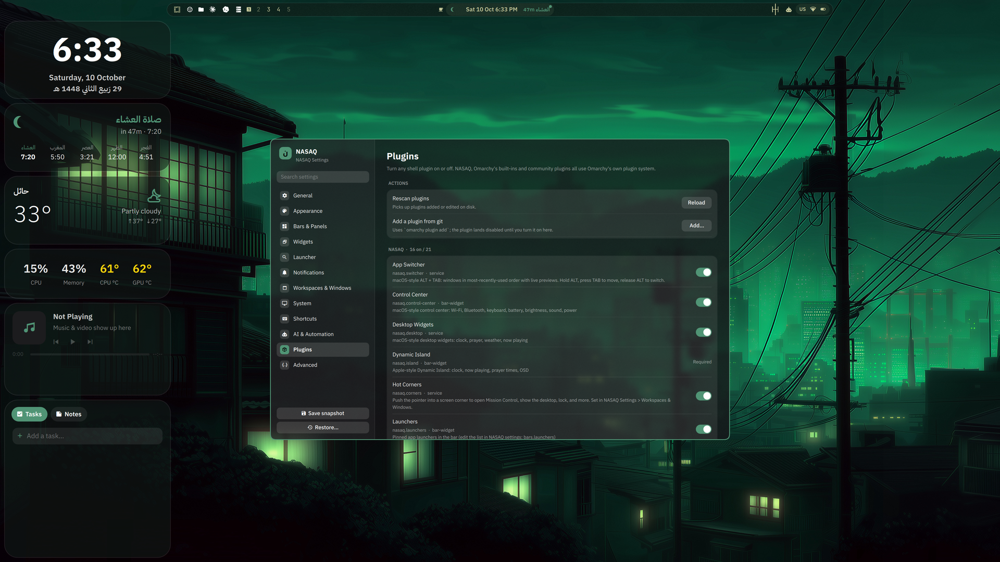

The Plugins page lists every plugin the shell knows about, grouped as NASAQ, Omarchy and community, with a switch for each, a rescan button, and "Add a plugin from git". Plugins the rest of NASAQ depends on are marked Required.

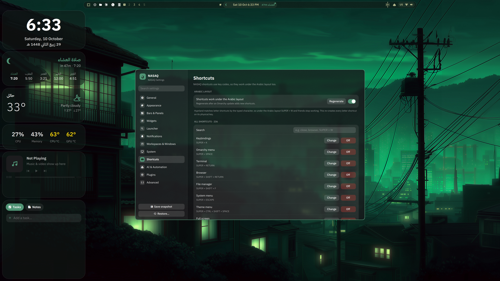

The Shortcuts page lists all shortcuts, Omarchy's and NASAQ's. Each can be changed to a different key or turned off, without editing Lua by hand and without losing Omarchy's updates: NASAQ writes a small remap layer that is loaded before Omarchy's defaults. The Arabic-layout switch regenerates every letter shortcut on key codes, so `SUPER + W`, `SUPER + Q` and friends keep working while the keyboard is in Arabic.

### More

- **Lock screen** with separate password and fingerprint flows, matching the theme.
- **Power**: an Apple-style Low Power Mode and per-profile behaviour (Saver, Balanced, Performance).
- **Display**: resolution, scale and position with a 15-second automatic revert, and auto-brightness from the ambient sensor or the clock.
- **Translation**: `SUPER + CTRL + ALT + L` translates the selected text; add SHIFT to OCR and translate a region of the screen. Both use your default Omarchy agent.
- **Universal clipboard**: `SUPER + C / V / X` copy, paste and cut in every app, including terminals.
- **Quit app**: `SUPER + Q` closes the whole application, not just one window.
- **Fix speakers**: `SUPER + ALT + A` rebinds the audio card when the speakers go silent (iMac and some laptops).
- **Window rules** and **automations** (time- or event-triggered commands), editable from Settings.
- **Screensaver modes**: Matrix, image, or Omarchy's stock ASCII.
- **Theme-aware**: every NASAQ surface follows the active Omarchy theme and updates when you change it.
- **Screen frame** (off by default): a soft rounded frame in the theme colour drawn inside the window gaps.

## Shortcuts

| Keys | Action |
|---|---|
| `SUPER + ALT + N` | NASAQ Settings |
| `ALT + SPACE` | Spotlight |
| `ALT + TAB` | App Switcher |
| `SUPER + TAB` | Mission Control |
| `SUPER + N` | Notification Center |
| `SUPER + ALT + C` | Control Center |
| `SUPER + ALT + D` | Show / hide desktop widgets |
| `` SUPER + ` `` | Terminal scratchpad |
| `SUPER + Q` | Quit app |
| `SUPER + C / V / X` | Universal copy / paste / cut |
| `SUPER + CTRL + ALT + L` | Translate selection |
| `SUPER + CTRL + ALT + SHIFT + L` | Translate a screen region (OCR) |
| `SUPER + ALT + A` | Fix speakers |
| `?` or `؟` in Spotlight | Ask the default agent |

All of Omarchy's own shortcuts stay as they are, and any of them can be changed from the Shortcuts page.

## Requirements

- Omarchy 4.0.4 or newer, which brings Hyprland 0.56+ and Quickshell 0.3+. NASAQ uses Hyprland's Lua configuration and Omarchy's plugin system.
- Optional packages the installer offers: `tesseract-data-ara` (Arabic OCR), `cava` (audio visualiser), `nwg-displays` (graphical display layout), `kitty` and `ptyxis` (scratchpad terminals).
- Optional: one of the Omarchy agents (`claude`, `codex`, `opencode`, `copilot`, `gemini`) for Spotlight questions and translation.
- Prayer times come from [AlAdhan](https://aladhan.com), weather from [Open-Meteo](https://open-meteo.com), currency rates from [open.er-api.com](https://open.er-api.com). All are free and need no key.

## Install

```bash
git clone https://github.com/ghazi-alsaif/nasaq ~/.local/share/nasaq
cd ~/.local/share/nasaq
./install.sh
```

The installer:

1. checks the Omarchy version and backs up `shell.json`, your three Hyprland Lua files and the menu extension into `~/.local/state/nasaq/`;
2. copies the plugins, scripts, hooks, sounds and defaults into your home directory;
3. adds one `pcall(dofile, ...)` line to each of `hyprland.lua`, `looknfeel.lua` and `bindings.lua`, so NASAQ's layers load with yours;
4. adds NASAQ's widgets to the bar and NASAQ's entries to the Omarchy menu;
5. offers the optional packages and the udev rule for the App Switcher (`sudo` for that one step);
6. restarts the shell.

`./install.sh --yes` accepts every optional step. When it finishes, press `SUPER + ALT + N`.

Set your city for prayer times and weather in Settings > Widgets. Pick the interface language in Settings > General.

## Update

```bash
cd ~/.local/share/nasaq && ./update.sh
```

`update.sh` pulls the latest release and runs `install.sh --update`, which refreshes NASAQ's files and leaves your bar layout, menu and settings alone.

## Uninstall

```bash
cd ~/.local/share/nasaq && ./uninstall.sh          # restores the backed-up files
cd ~/.local/share/nasaq && ./uninstall.sh --purge  # also removes NASAQ's settings
```

## Where things live

| Path | What |
|---|---|
| `~/.config/omarchy/plugins/nasaq.*` | the 21 plugins |
| `~/.config/omarchy/nasaq/` | settings.json, island.json, windows.json, help |
| `~/.config/omarchy/nasaq/secrets.json` | private calendar links (never exported or snapshotted) |
| `~/.config/hypr/nasaq-*.lua` | generated Hyprland layers (binds, rules, corners, scratchpads, Arabic binds, remaps) |
| `~/.local/bin/nasaq-*` | helper scripts (settings snapshots, display, translation, scratchpads, ...) |
| `~/.local/state/nasaq/` | install backups |
| `~/.local/share/nasaq-settings/` | the snapshot repository |

## Languages

The NASAQ interface is available in **English** (default) and **Arabic**, with automatic right-to-left layout for Arabic. Omarchy's own menus (such as `SUPER + SPACE`) stay in English. Arabic OCR and the Hijri calendar work regardless of the interface language.

## Credits and licence

NASAQ is made by **GHS (Ghazi Hamad Alsaif)** on top of [Omarchy](https://omarchy.org) by DHH and contributors, [Hyprland](https://hyprland.org) and [Quickshell](https://quickshell.org). Several plugins started as copies of Omarchy's own plugins and ideas from the community plugins credited in [NOTICE.md](NOTICE.md).

MIT licence. See [LICENSE](LICENSE) and [CHANGELOG.md](CHANGELOG.md).
